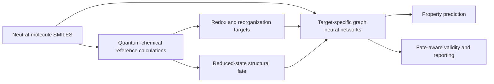

# Redox and Reorganization Energetics of Aryl Iodides with Fate-Aware Graph Neural Networks

This repository accompanies our study of redox and reorganization energetics in substituted aryl iodides using quantum-chemical reference calculations and graph neural networks. The workflow combines molecular-structure representations, electronic-structure calculations, reduction-fate characterization, and target-specific graph-learning models.

## Scientific workflow

## Status

The manuscript and associated computational resources are currently being prepared for publication. Code, curated data, trained models, reproducibility files, and full documentation will be released here soon.
