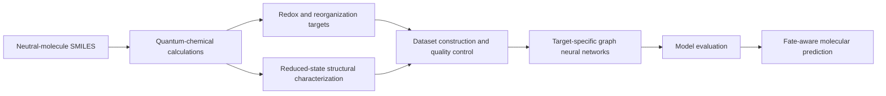
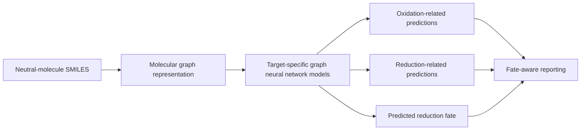

# Redox and Reorganization Energetics of Aryl Iodides with Fate-Aware Graph Neural Networks

This repository accompanies a computational study of redox and reorganization energetics in substituted aryl iodides. Quantum-chemical calculations are combined with graph neural networks to predict oxidation and reduction energetics, reorganization quantities, and the structural outcome of one-electron reduction.

The predictive models operate directly from the neutral-molecule structure, and reduction fate is used to determine whether fate-dependent quantities are appropriate to report for a given molecule.

## Overview

Substituted aryl iodides respond differently to one-electron reduction depending on their substitution pattern: some reduced structures remain structurally intact, while others show substantial elongation or outright dissociation of the carbon–iodine bond. Oxidation and reduction are therefore not treated as perfectly symmetric processes in this work.

Quantum-chemical reference calculations provide redox and reorganization-energy targets for a structurally diverse set of aryl iodides. Graph neural networks learn these quantities directly from molecular structure. Because the structural outcome of reduction varies across the dataset, reduction fate is treated explicitly as part of the predictive workflow, and fate-dependent quantities are reported only when the underlying structural assumption is appropriate.

## Workflow



*Figure 1. Overall computational workflow, from molecular representation and quantum-chemical reference calculations to target-specific graph learning and fate-aware prediction.*

## Prediction Workflow



*Figure 2. Inference workflow for a new molecule. Quantum-chemical calculations are used to construct the training and reference data; prediction for a new molecule is performed directly from its neutral-molecule representation, without requiring a new quantum-chemical calculation at inference.*

## Computational Methods

Production quantum-chemical calculations were performed with the following protocol:

- **Geometry optimization:** M06-2X-D3/def2-SVP/SMD(MeCN)
- **Single-point energies:** M06-2X-D3/def2-TZVPP/SMD(MeCN)
- **Overall notation:** M06-2X-D3/def2-TZVPP/SMD(MeCN)//M06-2X-D3/def2-SVP/SMD(MeCN)

Neutral, cation, and anion electronic states are considered for every molecule. Redox and reorganization quantities are derived from a seven-corner electronic-energy cycle involving the neutral, cationic, and anionic electronic states evaluated at the relevant optimized geometries.

Higher-level coupled-cluster calculations are used for focused benchmark and calibration calculations against the production DFT protocol. Full benchmark design, numerical results, and statistics will accompany the manuscript and its Supplementary Information.

## Predicted Properties

Four target quantities are predicted for each molecule:

- **Oxidation energy**, E_ox
- **Reduction energy**, E_red
- **Oxidative reorganization energy**, λ_ox
- **Reductive reorganization energy**, λ_red

A fifth quantity, **reduced-state structural fate**, is also predicted. Conventional reporting of λ_red is conditioned on the reduced-state structure remaining suitable for the corresponding reorganization-energy definition; fate prediction determines when that condition holds.

## Reduction-Fate Characterization

Reduced structures are examined for the structural response of the aryl carbon–iodine bond. Three conceptual categories are used:

- **Intact** — the carbon–iodine bond is retained with only modest relaxation.
- **Substantially elongated** — the bond is retained but significantly stretched.
- **Dissociated** — the bond is broken, giving a separated aryl fragment and iodide.

The structural outcome of reduction determines whether a conventional four-point reductive reorganization energy remains an appropriate quantity to report for a given molecule.

## Graph Neural Network Models

Target-specific graph neural networks are trained using neutral-molecule graph representations derived from SMILES. Separate predictive tasks are used for the different energetic quantities, and a classification task predicts reduction fate; the predicted fate is incorporated into the final, fate-aware reporting workflow.

Inference for a new molecule uses only its neutral molecular representation — optimized DFT geometries or other quantum-chemical quantities are not required at inference time.

## Quantum-Chemical Benchmarking

The production DFT protocol was independently assessed, including:

- alternative density functionals evaluated on common geometries;
- a representative molecular benchmark set;
- focused DLPNO-CCSD(T1) calculations;
- higher-stringency coupled-cluster calibration for selected calculations;
- solvation-correction sensitivity analysis.

Full benchmark structures, energies, and analysis will accompany the manuscript and its Supplementary Information.

## Software

| Software | Role |
|---|---|
| Gaussian 16 (Revision C.02) | Production DFT geometry optimizations and single-point calculations |
| ORCA 6.1.1 | DLPNO coupled-cluster benchmark calculations |
| Python | Data processing, model development, and analysis |
| PyTorch | Graph neural network implementation and training |
| PyTorch Geometric | Graph data structures and message-passing layers |
| RDKit | Molecular structure handling and descriptor generation |
| scikit-learn | Classical machine-learning baselines and preprocessing |
| XGBoost | Gradient-boosted-tree baseline models |
| pandas, NumPy, SciPy | Data handling and numerical analysis |
| Matplotlib | Figure generation |

Exact verified package versions are recorded in [`environment/README.md`](environment/README.md).

## Computational Resources

Quantum-chemical calculations were performed using high-performance computing resources. Data processing, graph-model development, and evaluation were carried out using Python-based scientific and machine-learning workflows.

## Repository Structure

```
aryl-iodide-redox-gnn/
├── README.md
├── .gitignore
├── environment/
│   └── README.md
├── data/
│   └── README.md
├── models/
│   └── README.md
├── scripts/
│   └── README.md
├── benchmarks/
│   └── README.md
├── docs/
│   └── figures/
└── results/
    └── README.md
```

Each directory currently contains a placeholder `README.md` describing what will be released there; the full contents will be added with the publication release.

## Data

The publication release will include curated molecular identifiers and SMILES, quantum-chemical reference quantities, structural-fate information, validity masks, and dataset split information.

The curated dataset and associated metadata will be released with the publication version of this repository.

## Reproducibility

The publication release will include:

- data-processing scripts;
- model-training configurations;
- evaluation scripts;
- dataset split definitions;
- trained final-model weights;
- software environment information;
- reproducibility metadata.

Verified environment details are recorded in [`environment/README.md`](environment/README.md).

## Repository Status

This repository is the companion repository for an associated manuscript that is currently being prepared for publication. The complete code, curated dataset, trained models, benchmark data, and reproducibility files will be released here shortly.

## Citation

Citation information will be added following publication of the associated manuscript.

## Authors

- Morteza Jamshidi
- Jason A. Smith
- Brian F. T. Yates
